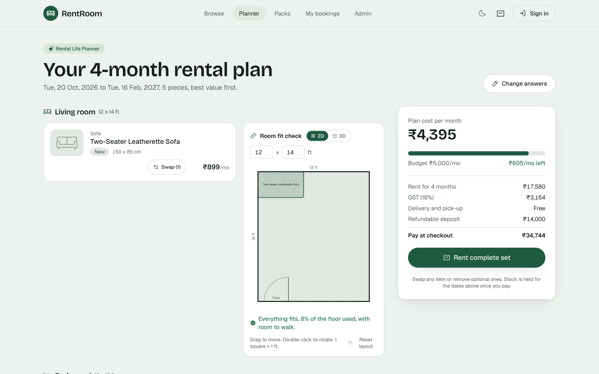
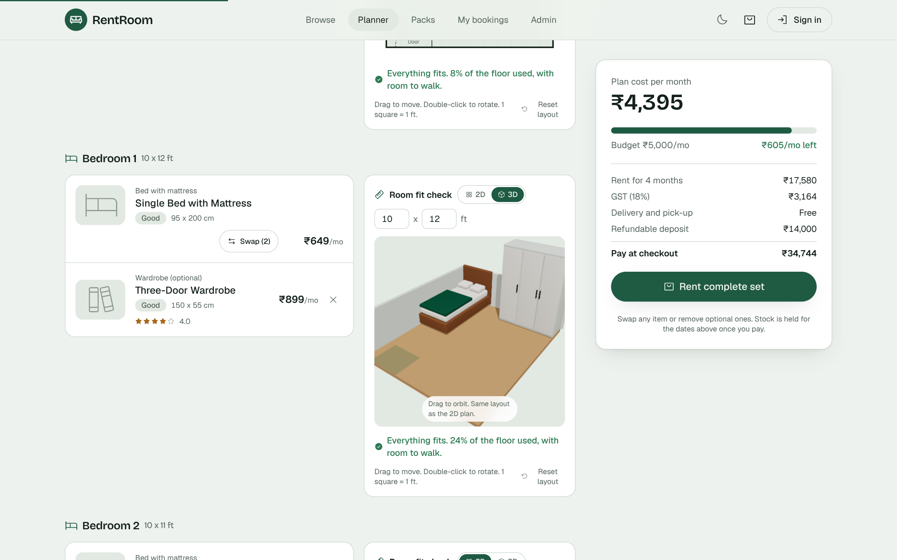
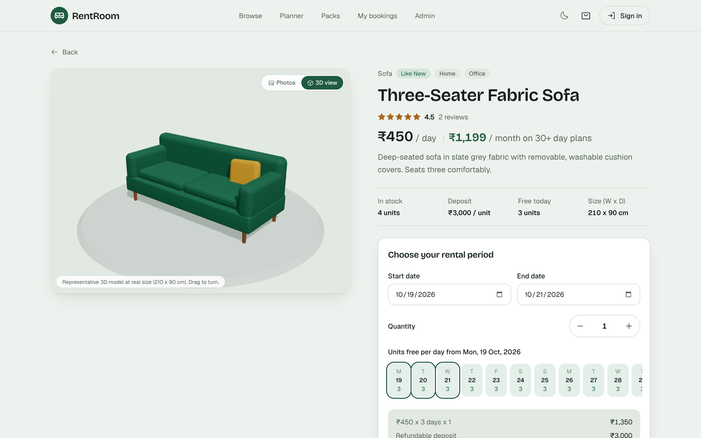
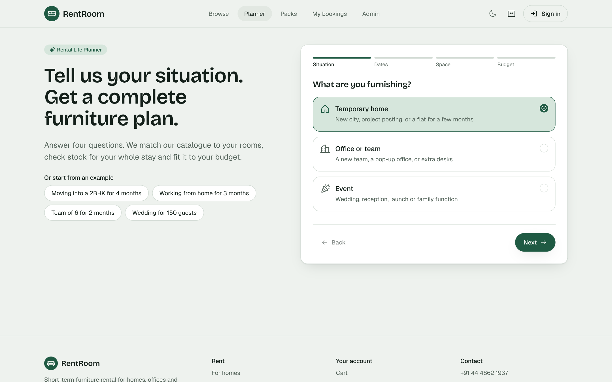
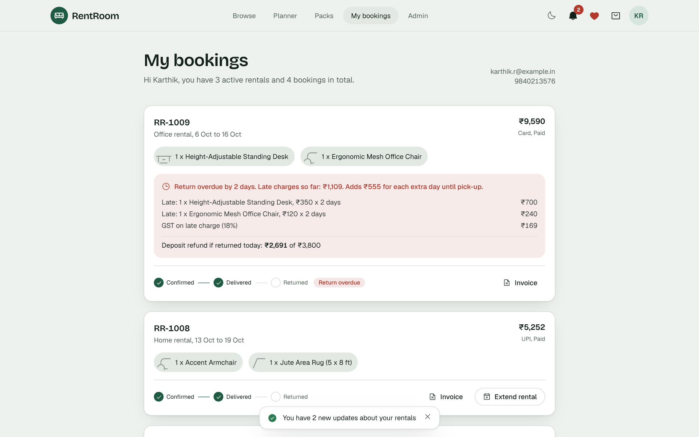
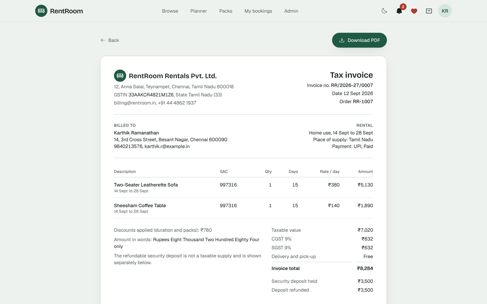
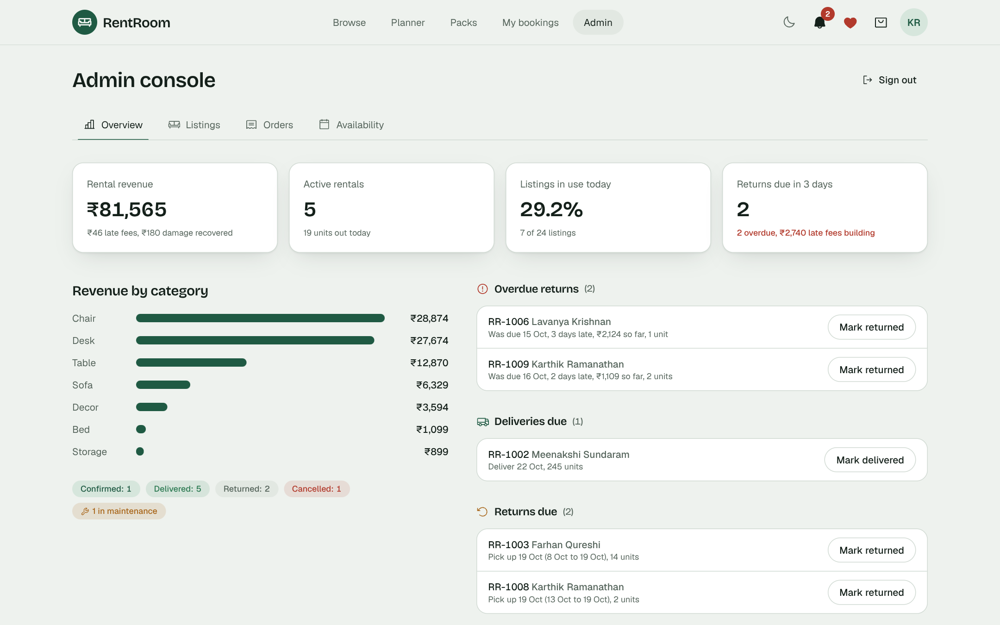
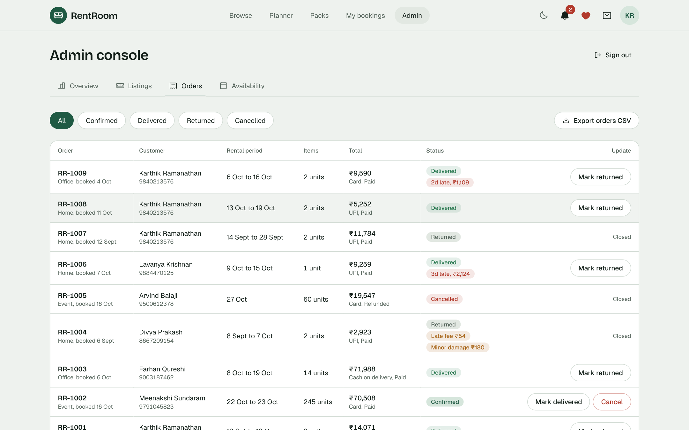
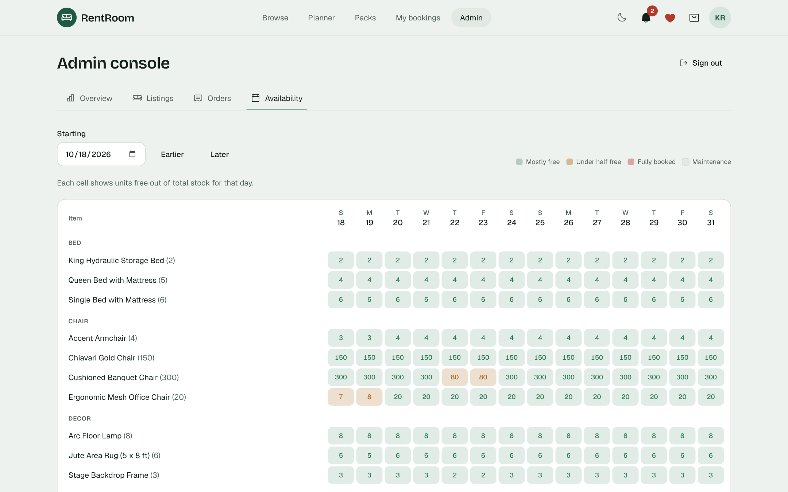
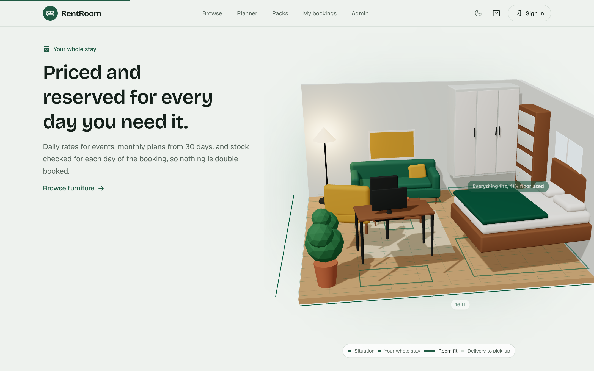

# RentRoom: Online Furniture Rental Platform

> Built at the **SRM MDU Hackathon**.


RentRoom lets customers browse furniture, choose rental dates, book and pay (mock payment). Administrators manage listings, rental orders and item availability.

Built with **React + Vite + Tailwind CSS + Motion** on the frontend and **Node.js + Express + SQLite** on the backend.

## Screenshots

| Rental Life Planner | Room Fit Check in 3D |
|---|---|
|  |  |
| **3D view on every item** | **Planner: tell us your situation** |
|  |  |
| **My bookings with late-return charges** | **GST tax invoice** |
|  |  |
| **Admin dashboard** | **Admin orders** |
|  |  |
| **Admin availability calendar** | **3D story on scroll** |
|  |  |

## Run it

Requires **Node.js 20.19 or newer** (check with `node -v`).

```bash
npm install
npm run dev
```

- Website: http://localhost:5173 (opens automatically)
- API: http://localhost:5000/api
- Admin console: http://localhost:5173/admin (password **admin123**)

The SQLite database file `server/rental.db` is created and filled with sample data on first run.
To start again with fresh sample data: `npm run reset-db`.

Single-port production mode: `npm run build` then `npm start`, then open http://localhost:5000.

## 3D landing page

The home page opens with a scroll-driven 3D story (Three.js via React Three Fiber, `client/src/components/Scene3D.jsx`). A studio flat built from simple shapes assembles itself on load, then chapter by chapter as you scroll: situation (armchair, bookshelf), whole stay (bed, wardrobe, desk), room fit (floor-plan grid, footprints and dimensions) and delivery to pick-up (camera pulls back, a ring circles the flat). The camera follows the mouse slightly, colours follow light and dark mode, the 3D code is lazy-loaded, rendering pauses when the section is off screen, and reduced-motion settings show the final state without animation. Browsers without WebGL get a static fallback.

### 3D across the site

- **3D showroom** on the landing page: each featured piece turns on a plinth; tabs switch pieces with a spring animation, it cycles on its own and you can drag to turn it.
- **3D view on every item page**: a "Photos / 3D view" toggle shows a representative 3D model scaled to the item's real width and depth.
- **Room Fit Check in 3D**: a "2D / 3D" toggle turns the floor plan into an orbitable 3D room with the same layout, pieces scaled to their real footprint, and clashes marked in red.
- **Tilt cards** with a light glare on furniture and pack cards, and **3D page transitions** between pages.

All 3D furniture is procedural (`client/src/components/furniture3d.jsx`), so there are no model files to host. 3D code is lazy-loaded only where it is shown.

## Headline feature: Rental Life Planner

Most rental sites make you search and rent one item at a time. RentRoom's planner starts from your situation instead:

1. **Situation**: temporary home, office or team, or event
2. **Dates**: delivery date and duration (1 to 6 months, or 1 to 7 days for events)
3. **Space**: rooms (living, number of bedrooms, dining, work corner), team size, or guest count
4. **Budget and priority**: budget per month (or total for events), best value or best condition

It then builds a complete plan from the live catalogue (`server/planner.js`, plain rules, no AI model):

```
situation -> required slots per room (essential or optional, with an importance weight)
          -> candidate items from the catalogue that are free for the WHOLE period (stock shared across the plan)
          -> pick by priority (cheapest, or newest and best rated)
          -> over budget? switch to cheaper options first, then leave out the least important optional items
          -> priced plan: cost per month, budget left, GST, deposit, total, and swap options for every slot
```

The customer can swap any item, remove optional ones, add left-out items back, and rent the complete set in one click (it goes to the cart with the plan's dates). One-click examples: "Moving into a 2BHK for 4 months", "Working from home for 3 months", "Team of 6 for 2 months", "Wedding for 150 guests".

**Room Fit Check** (part of the planner): enter each room's size in feet and the planner

- keeps only pieces that fit the room in either orientation, and checks the whole room: furniture plus 20% walking space may cover at most 60% of the floor. If a room is too full it swaps big pieces for smaller ones (a king bed becomes a queen or single), then leaves out optional pieces;
- draws a to-scale floor plan per room (1 grid square = 1 ft) with the door swing kept clear, and lays the pieces out automatically against the walls;
- lets the customer drag pieces and double-click to rotate them; overlaps and a blocked door turn red;
- flags anything too big ("King Hydraulic Storage Bed (190 x 215 cm) does not fit a 7 x 6 ft room") with a one-click swap to the cheapest piece that fits.

Every item stores its footprint (width x depth in cm), editable in the admin listing form.

**Monthly plan pricing**: every item has a daily price and a monthly plan price. Rentals of 30 days or more are charged at the monthly price, pro rata per day, the way long-term furniture rental is priced in practice. Admins set both prices.

## Features

**Customers**
- Browse 24 items with name, category, price per day, condition and live availability
- Filter by category, use (Home / Office / Event), condition, price, dates and search
- Item page with a 14-day availability strip, date range, quantity and a live price breakdown
- Automatic duration discounts: 10% for 7+ days, 25% for 30+ days
- Cart with separate dates per item, checkout with validation
- Mock payment: UPI, card or cash on delivery
- Customer registration and sign-in (email or mobile + password), with live password rules and a show/hide toggle
- Checkout requires an account; name, mobile and email are prefilled from it
- Order confirmation and "My bookings" for the signed-in customer, with cancellation before the start date
- **Extend rental**: pick a new end date (+3 / +7 / +30 days or any date), stock is checked for the extra days, pay for the extra days only
- **Wishlist**: heart any item to save it to your account, see it on the Wishlist page
- **Room packs**: ready-made sets (1BHK Starter, Work-from-Home Kit, Office Pod, Wedding 100 guests, Cocktail Evening) with a pack discount, one date range, availability of every item, added to the cart in one click
- **Ratings and reviews**: after the pick-up, rate each rented item with stars and a comment; averages show on cards and item pages
- **GST tax invoice** for every order (CGST + SGST split, SAC code, amount in words, deposit settlement), downloadable as PDF
- **Automatic reminders**: in-app bell (plus simulated SMS and email) for delivery tomorrow, rental ending in 2 days, pick-up tomorrow, ends today and a daily overdue notice with the late charge so far; also booking, extension, delivery, return and cancellation updates

**Administrators**
- Dashboard: revenue, active rentals, listings in use, returns due, overdue returns, revenue by category
- Listings: add, edit, delete (blocked when an item has active bookings), set Available / Maintenance / Unlisted
- Orders: filter by status, view details, move Confirmed → Delivered → Returned, or cancel
- Availability calendar: free units per item for each of the next 14 days
- **Pick-up check**: record the real return date and condition (Good / Minor 10% / Major 50% / Lost 100% of deposit, editable), optionally send items to maintenance; the deposit refund or balance due is calculated automatically
- **CSV export** of all orders and of all listings (opens in Excel)
- **Product images**: main and second image, each by pasting a link or uploading from the computer, with a live preview that says whether the image loaded
- **Reminder log**: every reminder sent, to whom and on which channels, with a "Run reminders now" button

## Core rules

**Availability** (checked per day, on the server, again at payment time):
```
booked(day) = sum of qty on Confirmed or Delivered orders covering that day
free        = stock - highest booked(day) across the requested period
```
A booking blocks only its own dates. Returned or cancelled orders release stock immediately.

**Late returns**: every day past the end date is charged at the booked daily rate × quantity (no discount) + 18% GST.
While an order is overdue the charge grows daily and the furniture keeps holding stock. When the admin records the return
(with the actual return date), the charge is taken from the refundable deposit; anything above the deposit becomes a balance due.
Damage charges come out of the same deposit, after late charges.
Change `LATE_FEE_MULTIPLIER` in `server/logic.js` to charge a penalty rate (for example 1.5).

**Pricing**: under 30 days, rent = price/day × days × qty (10% off from 7 days); from 30 days, rent = monthly price × qty × days / 30; packs take a further pack discount; GST 18%; delivery ₹299 (free above ₹5,000 rent); refundable deposit per unit.

## Demo data

| What | Value |
|---|---|
| Admin password | `admin123` |
| Card that succeeds | 4242 4242 4242 4242, any future expiry, any 3-digit CVV |
| Card that is declined | 4000 0000 0000 0002 |
| UPI | any ID like `name@okaxis` |
| Demo customer login | 9840213576 (or karthik.r@example.in), password `Rent@1234` |
| Second demo customer | meena.events@example.in, password `Rent@1234` |
| Late return demo | Karthik's order RR-1009 is 2 days overdue; Lavanya's RR-1006 is 3 days overdue |
| Reminder demo | Karthik's RR-1008 ends tomorrow, so a "pick-up tomorrow" reminder is sent on start-up |
| Review demo | Karthik's RR-1007 was returned, so its items can be rated |
| Test image links | Main: https://images.unsplash.com/photo-1555041469-a586c61ea9bc?w=900 , Second: https://images.unsplash.com/photo-1567538096630-e0c55bd6374c?w=900 |
| Fully booked demo | 220 banquet chairs are booked 4 to 5 days from the first run |

## Automatic reminders

`server/notify.js` runs on start-up and every 30 minutes. Each reminder has a unique key (type + order + date), so it is sent once even if the job runs many times. Messages are stored for the in-app bell and logged to the console as SMS/email sends. To send real SMS or email, add a provider call (MSG91, Twilio, SMTP) inside `deliver()` in that file.

## Database (SQLite)

- `furniture` (id, name, category, price_per_day, deposit, condition, stock, uses, status, description, image_url)
- `orders` (id, order_code, customer details, purpose, subtotal, discount, gst, delivery, deposit, total, payment_method, payment_ref, payment_status, status)
- `order_items` (id, order_id, furniture_id, qty, start_date, end_date, days, rent, deposit)
- `users` (id, name, email, phone, password_hash, created_at). Passwords are hashed with scrypt and a random salt.
- `sessions` (token, user_id, expires_at). Sign-in lasts 30 days.
- `orders.user_id` links each booking to the customer account.
- `order_extensions` (order_id, old_end, new_end, extra_days, rent, discount, gst, payment) records every extension.
- `wishlist` (user_id, furniture_id) holds saved items.
- `bundles`, `bundle_items` define the packs; `order_items.bundle_id` records pack bookings.
- `reviews` (furniture_id, user_id, order_id, rating, comment); one review per item per order.
- `notifications` (user_id, order_id, type, title, body, channels, dedupe_key, read_at).
- `furniture.width_cm`, `furniture.depth_cm` hold each item's footprint for the Room Fit Check.
- `furniture.image_url_2` holds the second image; uploaded files live in `server/uploads`.
- `orders` also stores returned_on, late_days, late_fee, late_gst, damage_level, damage_charge, damage_note, deposit_refund, balance_due.

## API

| Method | Endpoint | Purpose |
|---|---|---|
| GET | /api/furniture | List with filters and free units for a date range |
| GET | /api/furniture/:id | Item details |
| GET | /api/furniture/:id/availability | Free units per day |
| POST | /api/orders/quote | Validate stock and price a cart |
| POST | /api/payments/mock | Mock payment |
| POST | /api/auth/register | Create a customer account |
| POST | /api/auth/login | Sign in with email or mobile + password |
| GET | /api/auth/me | Current customer |
| POST | /api/auth/logout | Sign out |
| POST | /api/orders | Create an order (signed in) |
| GET | /api/my/orders | Signed-in customer's bookings |
| PATCH | /api/orders/:id/cancel | Customer cancellation (own orders only) |
| POST | /api/admin/login | Admin login |
| GET | /api/admin/stats | Dashboard numbers |
| GET/POST/PUT/DELETE | /api/admin/furniture | Manage listings |
| GET | /api/admin/orders | All orders |
| PATCH | /api/admin/orders/:id/status | Update order status (Returned takes an optional `returned_on` date) |
| GET | /api/admin/orders/:id/late?returned_on=&damage_level=&damage_charge= | Preview late + damage settlement |
| GET/POST | /api/orders/:id/extend | Quote / pay for a rental extension |
| GET, POST, DELETE | /api/my/wishlist(/:furnitureId) | Customer wishlist |
| GET | /api/admin/export/orders.csv, /api/admin/export/furniture.csv | CSV exports |
| POST | /api/planner | Rental Life Planner: situation in, priced plan out |
| GET | /api/bundles, /api/bundles/:id?from=&to= | Packs with availability and price |
| GET / POST | /api/furniture/:id/reviews, /api/reviews | Read reviews / rate an item |
| GET / POST | /api/my/notifications, /api/my/notifications/read | Customer notifications |
| GET / POST | /api/admin/notifications, /api/admin/reminders/run | Reminder log / run now |
| GET | /api/invoice/:code | GST invoice (owner or admin) |
| POST | /api/admin/upload | Upload a product image |
| GET | /api/admin/availability | Availability grid |

## Project structure

```
server/   index.js (API), db.js (SQLite), logic.js (pricing + availability), seed.js (sample data)
client/   index.html, src/pages (customer + admin screens), src/components, src/lib
```

Product photos load from Unsplash, so an internet connection is needed to see them. Without one, each item shows a category icon instead.
